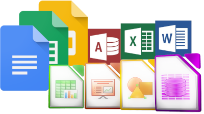

# Aplicaciones Ofimáticas

Bienvenido/a al espacio de **Aplicaciones Ofimáticas**.

Aquí encontrareis los contenidos, explicaciones, actividades y recursos del módulo.

## Contenidos

En esta web trabajaremos las siguientes herramientas:

- **Writer:** procesamiento de textos.[Writer](writer/index.md)
- **Calc:** hojas de cálculo.[Calc](calc/index.md)
- **Impress:** creación de presentaciones.[Impress](impress/index.md)
- **Base** gestión de bases de datos.[Base](base/index.md)